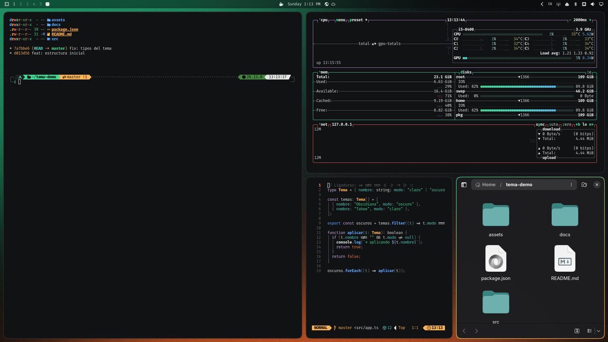

<a href="https://thealejandro.dev"><picture><source media="(prefers-color-scheme: dark)" srcset="docs/marca/logotipo.svg"></picture></a>

# Obsidiana

[English](README.md)

Un tema para [Omarchy](https://omarchy.org). Diseño propio, oscuro.

Un tema original: negro obsidiana, verde jade y un toque ámbar.



## Instalar

```bash
omarchy theme install https://github.com/thealejandro/omarchy-obsidiana-theme
```

### Esquinas redondeadas y colores del prompt (recomendado)

Omarchy ignora los archivos `.lua` de los temas instalados desde un repo, así que
este tema guarda el radio de las esquinas en `shape.toml`. Un pequeño hook de
[omarchy-themes](https://github.com/thealejandro/omarchy-themes) lo aplica, y otro recolorea el prompt
[Tide](https://github.com/IlanCosman/tide) (fish) a juego:

```bash
git clone https://github.com/thealejandro/omarchy-themes
omarchy-themes/install.sh
```

Sin los hooks el tema funciona igual; las ventanas solo conservan tus esquinas de siempre.

## Qué incluye

| Archivo | Para qué sirve |
| --- | --- |
| `colors.toml` | La paleta. Omarchy genera con ella la terminal, btop, Neovim, VS Code, la barra y lo demás. Acento `#3ddc97`, modo oscuro. |
| `icons.theme` | Iconos: `Yaru-prussiangreen-dark`. |
| `shape.toml` | Esquinas: 12 px, curvatura 4. |
| `hyprland.lua` | El mismo borde y esquinas, por si copias la carpeta a mano. |
| `backgrounds/` | Tres fondos de pantalla, hechos para este tema. |

Actualiza con `omarchy theme update`; quítalo con `omarchy theme remove obsidiana`.

Más temas: [thealejandro.dev/omarchy](https://thealejandro.dev/omarchy)

Hecho por [thealejandro](https://thealejandro.dev)

Sin relación con Apple ni Microsoft. [MIT](LICENSE)
